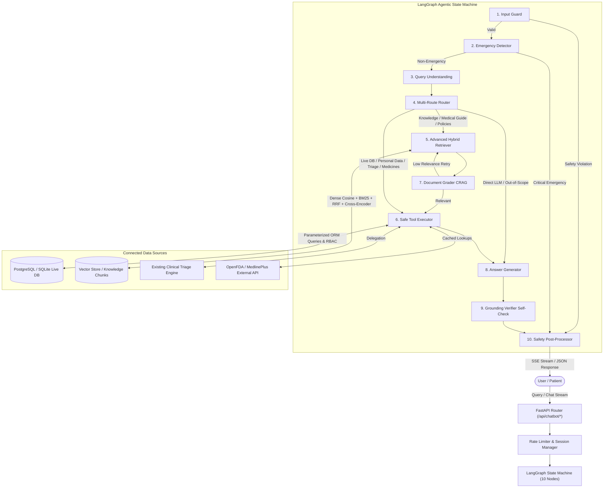

# PulseCare AI Healthcare Chatbot - Architecture & Technical Guide

The PulseCare AI Chatbot is an enterprise-grade, context-aware conversational agent designed for the PulseCare Smart Healthcare Appointment & Triage System. It enables patients to discover specialists, review live consultation schedules and transparent pricing, retrieve medication precautions, access personalized appointment records, and evaluate symptoms via PulseCare's clinical triage engine.

---

## 1. System Architecture



---

## 2. LangGraph 10-Node Workflow Specification

| # | Node | Purpose & Implementation |
|---|---|---|
| **1** | `input_guard` | Detects prompt injection (DAN mode, system prompt reveal, jailbreak attempts), masks PII (SSN, phone numbers), and enforces character limits (1500 chars). |
| **2** | `emergency_detector` | Rule-based regex + priority evaluation for life-threatening symptoms (chest pain, dyspnea, stroke signs, severe bleeding, suicidal ideation, poison). **Short-circuits immediately** with 911 / 988 emergency guidance. |
| **3** | `query_understanding` | Resolves pronouns and conversational coreferences against sliding window context. Extracts entities: `doctor_name`, `specialty`, `medicine_name`, `date`. |
| **4** | `router` | Classifies query into one or more parallel routes: `website_help`, `doctor_service_lookup`, `medicine_info`, `health_general`, `personal_data`, `triage_handoff`, `direct_llm`, `out_of_scope`. |
| **5** | `retriever` | Executes dense vector search + BM25 full-text matching fused with Reciprocal Rank Fusion ($k=60$) and Cross-Encoder reranking down to the top 4-6 chunks. |
| **6** | `tool_executor` | Parameterized execution of read-only tools: `search_doctors`, `get_doctor_profile`, `get_doctor_availability`, `list_services`, `get_my_appointments`, `lookup_medicine`, `handoff_to_triage`, `propose_appointment_booking`. Strict server-side RBAC. |
| **7** | `document_grader` | Corrective RAG (CRAG) evaluating retrieved chunk relevance. If weak, triggers query reformulation and retrieval retry (up to 2 loops). |
| **8** | `answer_generator` | Grounded synthesis strictly derived from evidence in retrieved chunks and tool results. Merges multi-route answers into structured sections. |
| **9** | `grounding_verifier` | Self-checking claim verification. Ensures all doctor names, fees, room numbers, and medical precautions exist in retrieved evidence. Returns honest fallback if ungrounded. |
| **10** | `safety_postprocessor` | Assigns visible badge (`Verified from PulseCare data` vs `General Information`), attaches citation metadata (source, section, last_updated), appends non-prescriptive medical disclaimers, and scrubs internal secrets/PII. |

---

## 3. Environment Configuration & Setup

### Environment Variables (`.env`)
Create a `.env` file from `.env.example`:

```bash
# Database Configuration
DATABASE_URL="sqlite+aiosqlite:///./pulsecare.db"
SYNC_DATABASE_URL="sqlite:///./pulsecare.db"

# Security
SECRET_KEY="your-production-secret-key-32-chars-min"
ALGORITHM="HS256"
ACCESS_TOKEN_EXPIRE_MINUTES=1440

# LLM Provider Configuration (mock | gemini | openai | anthropic)
LLM_PROVIDER="mock"
LLM_MODEL="gemini-2.5-flash"
LLM_API_KEY=""
LLM_TEMPERATURE=0.1

# Embeddings & Reranker
EMBEDDING_PROVIDER="mock" # mock | huggingface | openai | gemini
EMBEDDING_MODEL="text-embedding-3-small"
EMBEDDING_DIMENSION=384
RERANKER_PROVIDER="simple" # simple | cross-encoder | cohere

# Feature Flags
FEATURE_PROPOSE_BOOKING=true
FEATURE_EXTERNAL_MEDICINE_API=true
CHAT_RATE_LIMIT_PER_MINUTE=30
```

### Database Seeding & Ingestion
```bash
# 1. Seed clinical doctors, departments, medicines, and sample patient accounts
python scripts/seed_data.py

# 2. Ingest hospital knowledge base, FAQ, and policies into vector store
python scripts/ingest_knowledge.py
```

### Running Backend & Frontend
```bash
# Backend (FastAPI on port 8000)
uvicorn backend.app.main:app --host 127.0.0.1 --port 8000 --reload

# Frontend (Vite on port 5173)
cd frontend
npm run dev
```

---

## 4. How to Add New Documents to the Knowledge Base

1. Place your new Markdown (`.md`) or text file in `knowledge_base/` (e.g. `knowledge_base/new_clinic_policy.md`).
2. Format sections with standard Markdown headers:
   ```markdown
   # Department Title
   
   ## Section Name
   Detailed policy description...
   ```
3. Run the ingestion script:
   ```bash
   python scripts/ingest_knowledge.py
   ```
   Or trigger re-indexing via the admin API endpoint:
   ```http
   POST /api/chatbot/admin/ingest
   Authorization: Bearer <ADMIN_JWT_TOKEN>
   Content-Type: application/json
   
   {"reindex": true}
   ```

---

## 5. How to Add a New Tool

1. Define a strict Pydantic input schema in `backend/app/chatbot/tools/schemas.py`:
   ```python
   class MyNewToolInput(BaseModel):
       param: str = Field(..., description="Parameter description")
   ```
2. Implement the async tool function using parameterized ORM queries in `backend/app/chatbot/tools/`:
   ```python
   async def my_new_tool(db: AsyncSession, param: str) -> Dict[str, Any]:
       # Always use parameterized ORM queries; NEVER raw SQL
       ...
   ```
3. Register the tool execution in `backend/app/chatbot/tools/registry.py`:
   ```python
   elif tool_name == "my_new_tool":
       validated = MyNewToolInput(**tool_args)
       return await my_new_tool(db=db, param=validated.param)
   ```
4. Map routing cues in `backend/app/chatbot/graph/nodes/router.py` and `tool_executor_node.py`.

---

## 6. Healthcare Safety & Patient Privacy Rules

1. **Non-Prescriptive Educational Framing**: The assistant NEVER prescribes medication, adjusts dosages, or offers definitive diagnoses.
2. **Mandatory Medical Disclaimer**: All health and medicine answers automatically include a non-prescriptive medical disclaimer.
3. **Emergency Precedence**: Emergency symptoms (chest pain, dyspnea, stroke, overdose, self-harm) immediately short-circuit to 911 / 988 emergency hotlines.
4. **Data Isolation (RBAC)**: Patient appointment records strictly query `current_user.id` from the validated JWT token. Prompt text cannot override caller identity.
5. **PII Redaction**: Phone numbers, SSNs, and internal system tokens are scrubbed at both input guard and post-processing stages.

---

## 7. Known Limitations & Production Recommendations

1. **Vector Store**: Currently configured with vector cosine similarity compatible with PostgreSQL (`pgvector`) and an in-process fallback for local SQLite development. For high-scale multi-tenant enterprise deployments, enable Postgres `pgvector` indexing (`HNSW`).
2. **Reranker Latency**: The default `simple` reranker delivers fast < 50ms responses. For maximum semantic accuracy in multi-lingual settings, configure `RERANKER_PROVIDER=cross-encoder` with `cross-encoder/ms-marco-MiniLM-L-6-v2`.
3. **Telehealth Appointments**: Appointment booking proposals provide non-destructive deep links; final booking requires patient confirmation through the official booking portal.
